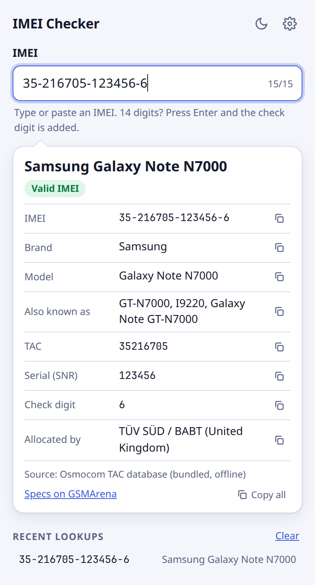
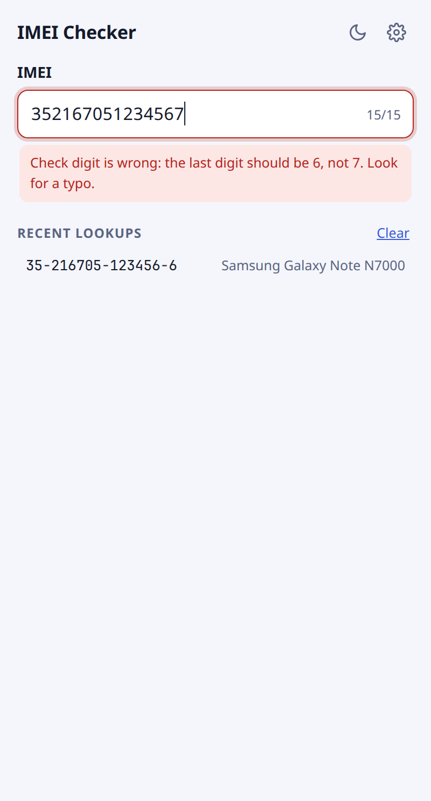
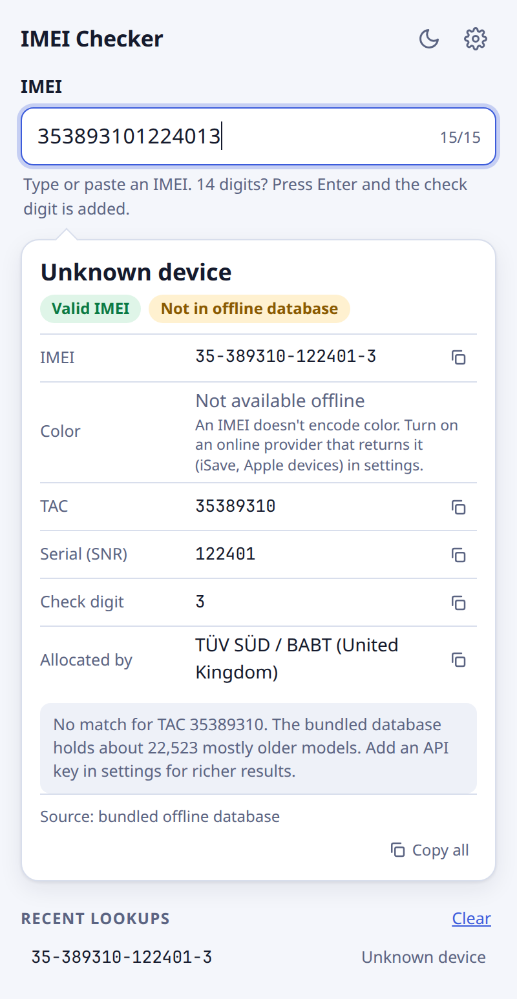
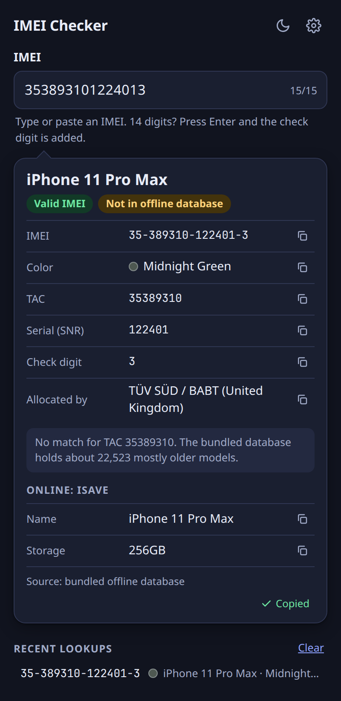

# IMEI Checker

A Chrome extension (Manifest V3). Click the icon, type or paste an IMEI, and the device shows up in a result card as soon as you reach 15 digits (or press Enter). Brand and model come from a TAC database bundled in the extension, so lookups are instant and work offline.









_The last screenshot used a locally simulated iSave response._

## What it does

- Checks the format and the Luhn check digit and says what is wrong ("the last digit should be 6, not 7").
- Accepts spaces and dashes. With 14 digits it calculates the check digit for you (press Enter).
- Shows brand, model, alternate model names, TAC, serial portion, check digit, the body that allocated the TAC, and a link to the model's GSMArena page when the dataset has one.
- A Color row on every card. Color is not in the offline data and an IMEI does not encode it, so the row says "Not available offline" until an online provider that returns color is enabled (see below). When it is known, the row shows a swatch dot (for recognised color names), the name and a copy button.
- Copy buttons on every row, plus "Copy all" (which includes color when known).
- Recent lookups (last 10, stored locally, one click to clear) with device name and color when known. Can be turned off in settings.
- Light and dark theme (follows the system, toggle in the popup).
- Right-click selected text and choose **Check IMEI** to look up an IMEI found on any page.
- Optional online lookup with your own API key (see below).

## Install (unpacked)

This is how the extension is loaded for development and review. Running your own copy needs written permission, see [License](#license).

1. Clone this repo.
2. Open `chrome://extensions` and turn on **Developer mode**.
3. Click **Load unpacked** and pick the repo folder (the one containing `manifest.json`).
4. Pin the icon and click it. Chrome 127 or newer is required (the context menu opens the popup with `chrome.action.openPopup`).

There is no build step. The files in the repo are the extension.

## Data source and license

The offline lookup uses the **[Osmocom TAC database](http://tacdb.osmocom.org/)**, a community-maintained list of Type Allocation Codes, downloaded from `http://tacdb.osmocom.org/export/tacdb.csv` on 2026-11-18.

- License: **Creative Commons Attribution-ShareAlike 3.0 Unported** ([summary](https://creativecommons.org/licenses/by-sa/3.0/), [legal code](https://creativecommons.org/licenses/by-sa/3.0/legalcode)). The CSV header reads "Osmocom TAC database under CC-BY-SA v3.0 (c) Harald Welte 2016".
- `data/tacdb.json` is an adapted form of that data (CSV converted to compact JSON, brand names shared in a table, duplicate aliases removed, GSMArena links reduced to a path, contributor and comment columns dropped). It stays under CC BY-SA 3.0.
- Credit and the list of changes are in [`DATA-LICENSE.md`](DATA-LICENSE.md). That license stays with the data file and any adaptation of it.

What it contains: 22,523 TACs across 568 brands. Osmocom is crowdsourced, so it is strongest on older phones and misses many recent models. A miss is shown as "Not in offline database", never guessed. The authoritative list is the GSMA's, which is not public.

I looked at a couple of larger GitHub compilations of TAC lists but did not bundle them: their provenance and redistribution rights are unclear (one merges Osmocom with a carrier list). If you have a dataset you are allowed to redistribute, convert it to the same CSV layout and run `npm run build:data -- your.csv`.

To refresh the bundled data:

```sh
curl -o tacdb.csv http://tacdb.osmocom.org/export/tacdb.csv
node scripts/build-tacdb.mjs tacdb.csv    # writes data/tacdb.json
```

## Online lookup (optional)

For carrier, blacklist and spec details the offline data cannot give, add your own API key in the settings page (gear icon, or the extension's Options).

Two providers are implemented, selectable in settings (one active at a time):

| Provider | Request | Returns | Color? |
| --- | --- | --- | --- |
| **[ImeiDB](https://imeidb.xyz/api)** | `GET https://imeidb.xyz/api/imei/{imei}`, key in `X-Api-Key` | name, brand, model, manufacturer, device type, specs, blacklist status | **No.** Its documented response has no color field. |
| **[iSave](https://imeigsx.com/api_documentation)** | `POST https://api.imeigsx.com/api/v1/check` with `{"command":"81","identifier":imei}`, key in `X-API-Key` | model name, storage, **color** (Instant Check 81, "Model + Color + Storage") | **Yes, Apple devices only.** Paid per check (about $0.02 at time of writing). |

Only iSave returns color, and only for Apple devices; for anything else the Color row says it was not returned. Neither check as called here reports carrier lock or warranty. ImeiDB and iSave requests, response mapping and error codes follow their public documentation, and the unit tests use the documented examples and field names. iSave's field reference lists `color` / `colour` / `capacity` but does not print a sample payload for check 81, so the mapping reads those names (and falls back to a `Color:` line in its text `result`).

How it is wired:

- Keys live in `chrome.storage.local` only (never synced, never in the code).
- Each provider host (`https://imeidb.xyz/*`, `https://api.imeigsx.com/*`) is an *optional* host permission. Chrome asks for it when you save settings with online lookup turned on.
- Nothing is sent anywhere unless online lookup is on and a key is saved. The offline result always shows first; online results are added to the card, and a failed online call never hides the offline answer.

### Adding a provider

A provider is a small object in `src/providers/`:

```js
export const myProvider = {
  id: 'myprovider',
  name: 'My Provider',
  docsUrl: 'https://example.com/docs',
  signupUrl: 'https://example.com/signup',
  hostPermission: 'https://api.example.com/*',
  provides: 'carrier, warranty',
  returnsColor: false, // true if lookup can fill in `color`; the UI explains this to the user
  async lookup(imei, apiKey, fetchFn = fetch) {
    const res = await fetchFn(`https://api.example.com/v1/${imei}`, { headers: { Authorization: `Bearer ${apiKey}` } });
    if (!res.ok) throw new Error('Provider said no.');
    const body = await res.json();
    return {
      fields: [{ label: 'Carrier', value: body.carrier }],
      color: body.color ?? null, // shown as the Color row with a swatch; null if unknown
      status: { label: 'Blacklist', value: 'Clean', level: 'good' }, // optional; level is good, warn or bad
    };
  },
};
```

Then:

1. Add it to the `providers` array in `src/providers/index.js`.
2. Add its host to `optional_host_permissions` in `manifest.json` (a test checks every provider's host is declared).
3. Add tests like `test/provider.test.mjs` (pass a fake `fetchFn`).

`lookup` returns `{ fields, color, status? }` and throws an `Error` with a message the user can read. The popup and settings page pick it up from the list.

## Development

```sh
npm test                  # unit tests (Node 20+, no dependencies)
npm run build:icons       # regenerate icons/ (pure Node, no dependencies)
```

Layout:

```
manifest.json
src/imei.js           parsing, Luhn, finding an IMEI in text
src/tac.js            loads data/tacdb.json, TAC lookup
src/lookup.js         offline result + optional provider
src/providers/        provider interface, ImeiDB, iSave
src/colors.js         color name -> swatch
src/storage.js        settings and history (chrome.storage.local)
src/popup/            the popup UI
src/options/          settings page
src/background.js     "Check IMEI" context-menu item
data/tacdb.json       bundled TAC data (CC BY-SA 3.0)
scripts/              data and icon generators
test/                 node:test suites
```

## License

The code in this repository is proprietary. Copyright SageWorkx, all rights reserved. The source is public so you can read it, but you may not copy, modify, redistribute, fork for use or use it commercially without written permission. See [`LICENSE`](LICENSE).

The bundled TAC dataset (`data/tacdb.json`) is a different case: it comes from the Osmocom TAC database and keeps its own CC BY-SA 3.0 license, described in [`DATA-LICENSE.md`](DATA-LICENSE.md). The proprietary license does not apply to it and it does not change that license.

Security reports: see [`SECURITY.md`](SECURITY.md).

## Privacy

See [`PRIVACY.md`](PRIVACY.md). Short version: no analytics, no remote code, nothing leaves your browser unless you turn on online lookup with your own key.

## Permissions

| Permission | Why |
| --- | --- |
| `storage` | Settings, your API key and recent lookups, all local. |
| `contextMenus` | The "Check IMEI" item on selected text. |
| `https://imeidb.xyz/*`, `https://api.imeigsx.com/*` (optional) | Only requested when you enable that provider's online lookups. |

No content scripts, no access to the pages you browse. The context menu only receives the text you selected, when you click it.

## Limits

- Color needs an online provider that returns it (iSave, Apple only). Offline it is shown as unavailable, never guessed from the model.
- The offline database is small and old-leaning, so many current phones will show as not found until you use an online provider.
- A TAC identifies a device model. Neither the TAC nor the check digit proves a particular phone is genuine, unlocked or clean.
